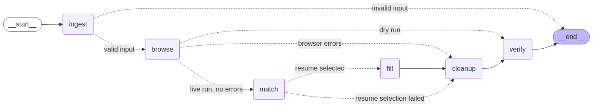

# AutoJobApply

A [LangGraph](https://langchain-ai.github.io/langgraph/) agent that logs in to
LinkedIn, searches for jobs, selects the **Easy Apply** filter, opens a job's
**Easy Apply** application form, picks the best-matching resume, and starts
filling the form — all through a real browser (via
[browser-use](https://github.com/browser-use/browser-use)).

> Status: **Tasks 1-10** — log in, search `"software engineer"`, select the Easy
> Apply filter, open a job's Easy Apply form, read the job description, select the
> best-matching resume, fill known fields + attach the resume, and ask you in the
> browser about any question it cannot answer, remembering your answer for next
> time. For each form question an **LLM (Task 4.1/10)** classifies the question and
> answers it from the store — copying a stored answer, or **deriving** one the
> stored entries entail (e.g. a stored "years of experience with AI: 5" answers
> "Experience on AI? [Yes/No]" as **Yes**), always citing the stored key(s) it used
> and never inventing an answer. After **you** submit a job, the agent
> returns to the results list, opens the next unapplied job, and repeats. A live
> **status panel (Task 9)** on the LinkedIn page shows each step in plain language
> and exactly what the **LLM** is doing. The graph
> runs end-to-end in **dry-run** mode (no browser, no network); the browser layer
> is wired but opt-in. **No application is ever submitted by the agent.**

## Behaviour

The graph is `START -> ingest -> browse -> match -> fill -> await_submit -> next_job -> match -> ... -> cleanup -> verify -> END` (the `await_submit`/`next_job` pair is Task 8's loop):



> Regenerate the diagram (or the Mermaid source) with
> `python -m src.visualize --out docs/graph.png --mermaid-out docs/graph.mmd`.

1. **ingest** — validates the LinkedIn URL and the search query.
2. **browse** — runs Tasks 1-3's browser work in **one session**:
   - **Task 1:** opens Chromium, navigates to the login page, and checks whether
     you are logged in. If not, it **waits for you to log in** in the browser
     window (up to `AUTOJOB_SESSION_LOGIN_TIMEOUT_SECONDS`). Once logged in, it
     runs LinkedIn's **AI job search** — clicking the **"Try AI job search"**
     control and typing the query (default `"software engineer"`) into the AI
     prompt ("Describe the job you want") — then selects the **Easy Apply** filter
     on the results page. The classic jobs search bar is not used.
   - **Task 2:** reads the job list from those results, opens the first job that
     offers Easy Apply (skipping external-apply jobs), clicks its **Easy Apply**
     button, and confirms the application form opened. Before judging that
     button it checks the details pane really shows the job it clicked (an
     already-applied job's pane has no Easy Apply button at all), and re-clicks
     the card once if the pane did not switch — so a swallowed click can no
     longer look like "no Easy Apply".
   - **Task 6:** skips cards already marked **"Applied"** (e.g. "Applied · 5
     months ago") and opens the first unapplied job instead.
   - **Task 7:** when *every* card on the current results page is **"Applied"**,
     advances the results list to the next page (up to `_MAX_RESULT_PAGES`) and
     scans it again, until an unapplied job is found or there are no more pages.
     The number of pages visited is recorded (`pages_visited`). Paginating never
     opens or applies to a job by itself.
   - **Task 3 (read):** reads the open job's title, company, location, and
     description body from the details pane.
   The session is left **open** (registered under an opaque `browser_run_id`) so
   Task 4 can fill the same Easy Apply modal.
3. **match** — Task 3's offline half: lists every resume in the folder
   (`.pdf`, `.docx`, `.txt`, `.md`), has the **LLM** (Task 3.2) write a short
   profile for each one (skills, titles, seniority, years, domain) into
   `data/resume_descriptions.json`, then asks the LLM to pick the single
   best-matching resume, or **none**. The LLM is the only matching path — there is
   no deterministic scoring fallback. Resume files are never modified.
   - **Task 3.1:** when the LLM answers **none**, the agent first reuses a resume
     it remembered for a similar job; otherwise it shows a banner with a file
     picker, **pauses for you to upload a resume**, stores it in the folder, has
     the LLM describe it, and remembers its job profile
     (`data/resume_library.json`) so similar jobs reuse it without asking again.
     If you skip and nothing is available, the run stops instead of applying with
     an unmatching resume.
4. **fill** — **Task 4:** enumerates the still-open Easy Apply form and answers
   each question. **Task 4.1** classifies every question with an LLM
   (`OPENROUTER_API_KEY` + `AUTOJOB_LLM_MODEL`) and answers it from the store
   (`data/answers.json`) **by meaning**, and **Task 10** lets it **match or
   derive**: it may copy a stored answer, or produce a short answer the stored
   entries *entail* when no stored value can be copied verbatim (a positive
   "years of experience with artificial intelligence (ai)" entry answers
   "Experience on AI? [Yes/No]" as **Yes**). Every answer must cite the stored
   key(s) it used (`source_keys`); an answer with no existing cited source, a
   derive the cited values do not entail, or a choice answer that maps to none of
   the question's options is rejected and handed to Task 5 — the model never
   invents an answer or uses outside knowledge. A derived answer is cached in
   `data/derived_answers.json` (kept separate from the human-confirmed
   `answers.json`) so the same question is instant next time. It also attaches the
   chosen resume — preferring a resume already listed on the form over uploading
   a duplicate — and advances multi-step forms. A **checkbox** question ("select
   all that apply") is answered as one group: its options are treated as a single
   question, and a stored answer ticks every matching box. It **stops before Submit
   application** and never clicks it.
   - **Task 5 (inside fill):** when the LLM cannot choose a grounded answer, the
     agent shows a banner in the browser window saying it does not know the
     answer,
     **pauses for you to type it into the form field on the page** (the banner has
     no input of its own), reads the value you enter, fills the field, and saves
     the question → answer mapping. Task 4.1 reuses that answer next run — and, as
     a human-confirmed answer, it always takes precedence over a derived one.
     Choice
     fields (selects/radios) list their allowed options in the banner, and an
     answer that matches a visible option label is mapped to the right value.
     A dropdown's prompt ("Select an option") is never treated as your answer —
     opening the list or clicking away changes nothing — and a value recorded for
     one question is never reused as the answer to another.
     A **checkbox** question is asked **once** for the whole group and *every*
     option you tick is captured — the banner watches all of the group's options,
     so ticking any of them is saved under the group's question (and no tick you
     make is ever toggled off by the agent). Controls the form has **already filled** (e.g. LinkedIn's pre-filled *Email
     address* / *Phone country code* selects) are left as-is and never asked
     about. Click **Skip** in the banner to skip on purpose.
     Set `AUTOJOB_SESSION_ASK_HUMAN=false` to leave unknown questions unanswered
     instead of prompting. Questions you skip or leave unanswered are recorded and
     can be answered on a later run.
5. **await_submit** — **Task 8 (subtask 8.1):** leaves the browser open on the
   terminal step and **waits for you to submit** the application yourself (the
   agent **never** clicks **Submit application**). It polls for a submission
   confirmation ("Application sent" / "Done") or the job's card flipping to
   **"Applied"**, bounded by `AUTOJOB_SESSION_KEEP_OPEN_TIMEOUT_SECONDS`. A modal
   dismissed with X, or a closed window, without a confirmation is **not** a
   submission. On a detected submission the job is recorded (title, company,
   resume) on the Task 8 outcome.
6. **next_job** — **Task 8 (subtask 8.2):** back on the results list, re-reads the
   cards, skips the **"Applied"** ones (Task 6), paginates when a whole page is
   Applied (Task 7), and opens the first unapplied **Easy Apply** job, reading its
   description so `match` and `fill` run for it again. The loop repeats until
   `AUTOJOB_SESSION_MAX_JOBS` jobs have been submitted (default `5`; `0` = until no
   unapplied job remains), every job is Applied, you close the browser, or a step
   fails — each with a clear `stopped_reason`. The session is reused across
   iterations.
7. **cleanup** — releases the shared browser session on every path. The **agent
   never closes the browser**: the Chromium window is left open so you can inspect a
   failure and keep driving it yourself. At the last step (Task 4 only **Submit
   application** remains) the run waits for you to close the window (or
   `AUTOJOB_SESSION_KEEP_OPEN_TIMEOUT_SECONDS` elapses) and leaves it open either
   way. Run `autojob --clean-profile` to force-close a leftover browser.
8. **verify** — passes only when all of the above succeeded (including a clean
   Task 8 stop reason; your submission is never a failure). Otherwise the run fails
   and a full-page screenshot plus the page URL are recorded under `data/debug/`.

The browser interaction is deterministic (browser-use's CDP actor API). The resume
match (Task 3.2) and the answer choice (Task 4.1/10) use an LLM; the LLM never drives
the browser or submits anything.
The login gate is human: your session is stored in the persistent Chromium
profile under `data/profile`, so later runs skip the wait.

**Task 9 — live status in the browser.** While a run is active, a small panel is
injected into the same LinkedIn page (bottom-left, so it never covers the Task 5 /
Task 3.1 banners in the bottom-right). It updates in place and shows only the
latest step, saying in plain language what the agent is doing at each step ("Please wait —
searching for 'software engineer' jobs…"). Whenever the **LLM** is used it is shown
with an explicit `LLM:` label and a purple heading, naming exactly what it is doing
(summarising a resume, choosing the best-matching resume, classifying a form
question) and what it decided. For a Task 10 answer it also names the stored
source and whether the answer was **matched** or **derived** (e.g. `LLM: answered
'Experience on AI? [Yes/No]' - 'Yes' (derived from 'how many years of work
experience do you have with artificial intelligence (ai)': '5')`). The panel is
read-only, best-effort feedback: a failed render never fails or slows a step, and
it is removed when the run ends.

## Requirements

- Python 3.11 or 3.12
- [uv](https://docs.astral.sh/uv/)

## Setup

```bash
uv sync                        # core (no browser); includes pypdf for resumes
cp .env.example .env           # optional; defaults are safe
```

Put one or more resumes in `resumes/` (supported: `.pdf`, `.docx`, `.txt`, `.md`).

Task 4.1/10 needs an LLM to classify questions and answer them. Set it in `.env`:

```bash
OPENROUTER_API_KEY=sk-or-...          # required for Task 4.1
AUTOJOB_LLM_MODEL=deepseek/deepseek-v4.1-flash
```

Any OpenAI-compatible endpoint works via `AUTOJOB_LLM_BASE_URL`. Without a key
and model, no answer is chosen and **every** question is handed to Task 5 (ask
the human), so the run still works — it just prompts for every question.

To answer form questions automatically, add them to the answer store
`data/answers.json`. Task 4.1/10's LLM reads it and answers each question —
matching by meaning, not exact wording, and **deriving** an answer the stored
entries entail when no stored value can be copied verbatim; Task 5 also writes to
this file when it asks you a new question in the browser, so answers persist
across runs. Every auto-answer is grounded: the model must copy a stored value or
cite the stored key(s) it derived from, so it never invents one. Derived answers
are cached in `data/derived_answers.json` (a separate file, so `answers.json`
stays human-confirmed).
For example:

```json
{
  "phone number": "+61 400 000 000",
  "are you authorised to work in australia": "Yes",
  "years of experience": "5"
}
```

To enable real browser automation:

```bash
uv sync --extra browser
uvx playwright install chromium
```

## Run

```bash
# Offline dry run - validates the wiring, no browser is launched.
uv run autojob --dry-run

# Real run - opens Chromium, waits for login, searches, opens Easy Apply,
# reads the job, picks a resume, and fills the form (never submits).
uv run autojob --no-dry-run
uv run autojob --no-dry-run --query "software engineer" --resumes-dir ./resumes
```

Exit code is `0` only when all acceptance criteria pass. Add `--json` for the raw
final state.

The graph is also discoverable by the LangGraph CLI/Studio (installed in the
`dev` group):

```bash
uv run langgraph dev
```

## Layout

```
src/
  configuration.py   Typed settings from AUTOJOB_* environment variables
  state.py           The graph's shared state (Task1-8 outcomes, JobDescription)
  graph.py           Graph assembly (START -> ingest -> browse -> match -> fill -> await_submit -> next_job -> ... -> cleanup -> verify -> END)
  nodes/
    ingest.py        Validate the LinkedIn URL and search query
    browse.py        Tasks 1-3 browser work (login, search, Easy Apply, description)
    match.py         Task 3: describe the pool + LLM-pick the best resume (offline)
    fill.py          Task 4: fill the Easy Apply form + attach the resume
    apply_loop.py    Task 8: wait for the human's submit (await_submit) + open the next job (next_job)
    cleanup.py       Close the shared browser session (or leave it open at the last step)
    verify.py        Confirm every task's acceptance criteria
  tools/
    browser.py       browser-use session wrapper (opt-in); shared browser primitives,
                     run_agent / run_full_agent, the Task 3.1 / Task 5 banners, and
                     the Task 9 status reporter/panel
    linkedin.py      Pure LinkedIn URL/text helpers
    linkedin_search.py             Task 1: log in, search jobs, select Easy Apply filter
    linkedin_job_selection.py      Task 2: select a job, open its Easy Apply form
    linkedin_job_apply_button.py   Task 2: the details pane's job, apply button, modal
    linkedin_skip_applied.py       Task 6: skip cards already marked "Applied"
    linkedin_pagination.py         Task 7: when a page is all Applied, go to the next page
    linkedin_apply_loop.py         Task 8: detect the human's submit, open the next job
    linkedin_status_overlay.py     Task 9: the on-page status panel + status reporter
    linkedin_best_matching_resume.py
                     Task 3: read the job description, drive the LLM match;
                     Task 3.1: ask the human when nothing matches
    resume_descriptions.py  Task 3.2: LLM resume profiles + the LLM pick
    linkedin_easy_apply_fill/      Task 4: fill the Easy Apply form, attach the resume
      __init__.py                  Task 4 public API (re-exports the submodules below)
      form_queries/                DOM queries + readers for the form, resume controls, buttons
        __init__.py                re-exports the query scripts and readers
        scripts.py                 injected JS query scripts + findApplyRoot injection
        readers.py                 async readers over the scripts (read_form, read_resume_info, ...)
      field_filling.py             Fill one step's known fields (LLM / Task 5 answers)
      checkbox_groups.py           Answer a checkbox (multi-select) question as one group
      resume_attachment.py         Attach the Task 3 resume (listed option or CDP upload)
      form_walk.py                 Walk the form step by step, stopping before Submit
    llm_answers.py   Task 4.1: LLM classifies a question and picks the stored answer
    llm_answer_reasoning.py  Task 10: LLM matches *or derives* an answer, with grounding
    derived_answers.py  Task 10.3: cache of answers the LLM derived from the store
    linkedin_ask_human/  Task 5: banner, answer watcher/reader, wait flow, answer store
    matching.py      Pure keyword helpers (skills, titles, seniority) for 3.1 profiles
    answers.py       Question -> answer store (read by Task 4.1/10, written by Task 5)
    resume_library.py  Task 3.1: job profiles -> human-provided resumes
    forms.py         Pure Easy Apply form helpers (resume match, next/submit)
  main.py            CLI entry point
resumes/             Candidate resumes (.pdf, .docx, .txt, .md)
tests/
  unit/              Fast, offline tests
  integration/       Opt-in live browser / real-resume tests
```

## Troubleshooting

- **"another browser is already using the AutoJobApply profile …"** — another
  AutoJobApply run (or a window left open by an earlier one) still owns
  `data/profile`, so this launch stops instead of force-closing it. Closing a
  live browser that another run is driving tears down its CDP WebSocket and the
  reconnect attempts fail (`ConnectionRefusedError` / `WinError 1225`). Finish or
  close that run and retry; to force-close it deliberately:

  ```bash
  uv run autojob --clean-profile
  ```

  This only closes browser processes whose command line references the dedicated
  `data/profile`, so your normal Chrome is untouched. Set
  `AUTOJOB_SESSION_CLEAN_STALE_PROFILE=false` to skip the lock recovery.

- **"another browser is already using the AutoJobApply profile …"** — the agent
  never closes the browser, so the window from a previous run is still holding
  `data/profile`. Close that window (or run `uv run autojob --clean-profile`) before
  starting the next run.

- **"Browser process … exited before CDP became available"** — a **crashed**
  previous run left Chromium's single-instance lock in `data/profile` (with no
  live process). The agent clears that stale lock automatically on the next
  launch. If a browser is still alive, it stops with the message above instead of
  killing it; use `uv run autojob --clean-profile` to force it.

- **`Exception ignored in: … I/O operation on closed pipe` after a run** — a
  harmless Windows `asyncio` shutdown artifact from the browser subprocess. The
  CLI filters exactly that message, so it no longer clutters the output.

## Safety rails

- The browser is **opt-in**: `--no-dry-run` is required to launch it.
- **Login gate:** a real run pauses until you log in; it never types credentials.
- Task 4 answers via the LLM (Task 4.1/10), which only uses **stored** answers — it
  may copy one or **derive** one the stored entries entail, always citing the
  stored key(s) it used, so it can never invent an answer — attaches the chosen
  resume, and **never clicks Submit application** — submission stays a manual human
  step.
- Task 5 never guesses: when the LLM cannot choose a grounded answer, the run
  pauses on a browser banner and waits for you to type the answer into the form
  field. Answers are stored in `data/answers.json` (no credentials) and reused by
  Task 4.1/10; a human-confirmed answer always takes precedence over a derived one.
  The derived answers the LLM produced are cached separately in
  `data/derived_answers.json` (never written into `answers.json`).
- Unknown questions that you skip or leave unanswered are recorded rather than
  guessed. A checkbox (multi-select) question is answered as one group and keeps
  every option you tick; the agent never unticks a box you selected.
- Task 3 only **reads** existing resumes — it never renames, moves, or edits them.
  Task 3.2 stores LLM-written profiles in `data/resume_descriptions.json`. Task 3.1
  may **add** a resume you upload when nothing matches (never overwriting an
  existing file) and remembers its job profile in `data/resume_library.json`
  (profiles and paths only, no credentials) so similar jobs reuse it.
- On failure the page URL and a screenshot are saved for debugging.
- The Chromium profile under `data/profile` persists logins and is gitignored.
